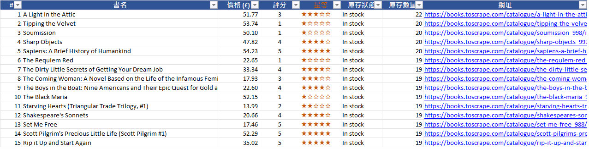

# scraper-demo：網頁資料擷取 → Excel

[](https://github.com/Marc-YULIN/scraper-demo/actions/workflows/ci.yml)  

C# / .NET 10 web scraper demo: crawls a practice site page by page and exports a formatted Excel workbook.

用 C# / .NET 寫的爬蟲示範：自動翻頁擷取書籍資料（書名、價格、評分、庫存），整理成可以直接使用的 Excel。

## 解決什麼問題

- 每天手動到網站複製資料、貼到 Excel，花時間又容易漏
- 想定期追蹤公開資訊（商品價格、公告、職缺），但資料分散在很多頁
- 抓下來的資料格式亂，還要再花時間整理

這個工具一次跑完：**擷取 → 清理 → 輸出格式化 Excel**。

## 執行畫面

```text
開始擷取 https://books.toscrape.com/catalogue/page-1.html
頁數上限：3｜詳細頁庫存：是｜請求間隔 1 秒

[第  1 頁] 取得 20 本，累計 20 本
[第  2 頁] 取得 20 本，累計 40 本
[第  3 頁] 取得 20 本，累計 60 本

抓取 60 本書的詳細頁庫存（約需 60 秒）…
  詳細頁 20/60
  詳細頁 40/60
  詳細頁 60/60

完成：60 本書，耗時 01:04
輸出檔案：books.xlsx
```

輸出的 `books.xlsx`：



| 工作表 | 內容 |
|---|---|
| 書籍清單 | 書名、價格、評分（數字＋★）、庫存狀態、庫存數量、可點擊的網址；標題列凍結、可篩選、欄寬自動調整 |
| 摘要 | 擷取時間、書籍總數、平均／最高／最低價格、5 星書籍數 |

## 功能重點

- **有禮貌地爬**：每次請求間隔至少 1 秒、帶固定 User-Agent，不對網站造成負擔
- **失敗自動重試**：連線錯誤、逾時、5xx、429 會重試 3 次（間隔 2、4、8 秒）；404 這類不會重試
- **自動翻頁**：沿著「下一頁」連結抓到最後一頁，或用 `--pages` 限制頁數
- **資料清理**：價格轉成數字、星等轉成 1–5、處理網站編碼造成的「£」亂碼
- **中斷也不白跑**：按 Ctrl+C 會停止擷取，但已抓到的資料仍會存成 Excel
- **有測試**：解析邏輯與重試機制共 15 個單元測試

## 執行方式

需要 [.NET 10 SDK](https://dotnet.microsoft.com/download)。

```bash
git clone https://github.com/Marc-YULIN/scraper-demo.git
cd scraper-demo

# 抓前 3 頁（約 3 秒）
dotnet run --project src/ScraperDemo -- --pages 3

# 抓前 2 頁，並逐本開詳細頁抓庫存數量
dotnet run --project src/ScraperDemo -- --pages 2 --details --output sample.xlsx

# 執行測試
dotnet test
```

| 參數 | 說明 |
|---|---|
| `--pages <N>` | 只抓前 N 頁（每頁 20 本），預設抓全部 50 頁 |
| `--details` | 逐本開詳細頁抓「庫存數量」，每本多 1 秒 |
| `--output <檔名>` | 輸出檔名，預設 `books.xlsx` |

## 專案結構

```text
src/ScraperDemo/
  Program.cs              命令列參數、流程控制、Ctrl+C 處理
  PoliteHttpClient.cs     請求間隔、User-Agent、重試
  BookPageParser.cs       用 AngleSharp 解析列表頁與詳細頁
  ExcelExporter.cs        用 ClosedXML 輸出格式化 Excel
tests/ScraperDemo.Tests/  單元測試（xUnit）
```

使用套件：[AngleSharp](https://github.com/AngleSharp/AngleSharp)（HTML 解析）、[ClosedXML](https://github.com/ClosedXML/ClosedXML)（Excel，MIT 授權，商用免費）。

## 可客製成什麼服務

- **比價／價格追蹤**：每天抓競品價格，價格變動時通知
- **公開資訊彙整**：政府公告、招標、職缺、活動資訊整理成表格
- **商品清單整理**：把供應商網站的商品資料轉成上架用的 Excel／CSV
- **定時自動執行**：搭配 Windows 工作排程器，每天固定時間產出報表，並寄信或用 LINE 通知
- **動態網頁**：需要執行 JavaScript 才會出現資料的網站，可改用 [Playwright for .NET](https://playwright.dev/dotnet/)

## 注意事項

- 本範例的目標網站 [books.toscrape.com](https://books.toscrape.com) 是專供爬蟲練習的網站
- 實際案件只擷取允許擷取的公開資料：不繞過登入、不破解驗證碼、不蒐集個人資料，並遵守網站使用條款

## 授權

[MIT](LICENSE)
